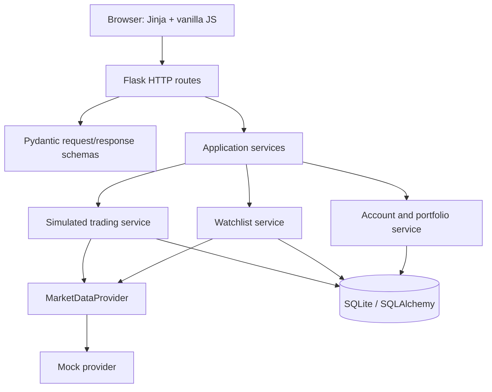

# TradePoint — Architecture and Parallel Development Plan

**Status:** Preparation proposal based on the repository inspected on 7 November 2026. This document does not implement future features. The existing watchlist MVP remains the working baseline. `CONTRACTS.md` remains authoritative for the watchlist/provider APIs until an explicitly reviewed contract amendment is made.

> **Scope input is incomplete:** The supplied product request ends at “Trading will initially use simulated”. This plan covers only the complete feature list received: account/portfolio, watchlist, and simulated buying/selling/order history. Any further text after that cutoff may add constraints; review it before treating this plan as final for trading behavior.

## 1. What exists now

The repository is a compact Flask modular application, not a package-based application:

| Existing file | Current role |
|---|---|
| `app.py` | Flask app factory and four watchlist/search routes; initializes DB and seeds the provider at startup; common JSON errors. |
| `services.py` | Search/cache, watchlist add/list/delete, quote mapping. |
| `provider.py` | `MarketDataProvider`, normalized `InstrumentData`/`QuoteData`, mock market data, `ProviderUnavailable`. |
| `schemas.py` | Pydantic request/response validation. |
| `models.py` | SQLAlchemy `Instrument` and `WatchlistEntry`. |
| `database.py` | Shared engine/session and SQLite foreign-key setup. |
| `config.py` | Database URL, demo user ID, secret key. |
| `templates/index.html` | One-page Bootstrap/vanilla JS watchlist interface. |
| `CONTRACTS.md` | Approved watchlist contracts and ownership proposal. |
| `README.md`, `requirements.txt` | Run and dependency instructions. |

The implementation is currently a single-user demo with persistent SQLite storage and simulated quotes. There are no account, cash, holding, order, trade, or transaction-history tables or endpoints. Do not treat those product areas as implemented.

## 2. Recommended architecture: keep the modular monolith

Keep one Flask process, one SQLAlchemy database, one Pydantic API boundary, and the current provider abstraction. Add domain service modules as features arrive; do not introduce microservices, message queues, background workers, CQRS, or a general plugin framework for this scope.

Routes should parse/validate, call a service, and map domain errors to HTTP. Services own business rules and transaction boundaries. SQLAlchemy models persist state. Provider adapters own external market-data translations; they must return normalized application types. Browser JavaScript owns display and interaction only.

## 3. Proposed future domain boundaries

Add these modules only when the corresponding feature is started. They are logical boundaries, not a demand to split the application into many files immediately.

| Area | Responsibility | Owns state/rules |
|---|---|---|
| Instrument catalog and quotes | Search normalized equities; quote lookup through provider. | Instrument identity and quote freshness/availability semantics. |
| Watchlist | Add/list/remove watched instruments. | Membership only; a watched stock is not an owned holding. |
| Account | Demo account and cash ledger/balance query. | One demo account identity and cash balance source of truth. |
| Simulated trading | Validate and execute buy/sell requests atomically. | Order lifecycle, idempotency, cash/holding checks, transaction records. |
| Portfolio | Read-only aggregation of holdings, prices, valuation, and P/L. | Calculation definitions; should not independently mutate balances. |

Suggested future module names: `services.py` can initially remain for watchlist; when trading/portfolio work begins, create `account_service.py`, `trading_service.py`, and `portfolio_service.py`. Keep `app.py` routes thin. Do not create these files until work begins, to avoid empty abstraction scaffolding.

## 4. Suggested persistence model for future scope

Keep existing `instruments` and `watchlist_entries` as specified in `CONTRACTS.md`. Add tables in feature-specific migrations or a deliberate development database reset; `Base.metadata.create_all()` does not migrate existing schemas.

| Future table | Purpose and important constraints |
|---|---|
| `accounts` | Demo account identity and currency. Unique stable account/user key. No authentication implied. |
| `cash_ledger_entries` | Append-only cash movements with signed `NUMERIC`/decimal amount, reason, timestamp, and optional order reference. Balance is sum of entries, or a cached balance updated in the same transaction. Choose one authoritative approach before coding. |
| `orders` | User/account, symbol/instrument, side, quantity, order type, requested price if applicable, status, idempotency key, created/updated times. Unique `(account_id, idempotency_key)` prevents replayed submissions. |
| `trades` | Executed fill facts: order, instrument, side, quantity, execution price, timestamp. Keep immutable after execution except explicit correction records. |
| `holdings` (optional projection) | Current quantity and average cost per account/instrument. If persisted, update in same transaction as trade/cash ledger, and provide a reconciliation path from trades. Avoid maintaining the same truth in two places without tests. |
| `watchlist_entries` | Existing membership table; do not infer ownership from membership. |

Use `Decimal` in Python and SQL `NUMERIC` for money and share quantities; never use float. Ensure serialized API money follows a single chosen string format (recommend fixed two-decimal strings for INR amounts, consistent with `CONTRACTS.md`). Quantities need a separately chosen decimal scale if fractional shares are supported; do not assume integer shares until decided.

### Trading transaction boundary

A simulated market/limit execution must be one SQLAlchemy transaction: validate request and idempotency key; read account/cash and holding state; validate sufficient cash/quantity; create/transition order; create trade/fill; append cash ledger; update holding projection if used; commit. On any failure, roll back all writes. Repeated idempotency keys return the original result and must not execute twice. SQLite concurrency should be treated carefully; use an explicit write transaction/locking strategy or serialize writes in the application. The exact approach should be proven under concurrent requests before multi-user use.

## 5. API growth rules

Keep existing four watchlist routes and response bodies unchanged unless an intentional breaking contract revision is approved. Future endpoint groups should be additive and described in Pydantic schemas before independent implementation. Suggested resource boundaries (names are proposals, not finalized schemas):

- Account read: account summary and available cash.
- Portfolio read: holdings plus valuation/P&L summary.
- Orders: submit, retrieve status, list history.
- Trades/transactions: read-only history.
- Watchlist: existing routes.

Before coding each group, define exact JSON field names/types, Decimal wire serialization, nullable quote semantics, status enum values/transitions, error codes/statuses, idempotency behavior, and service signatures. Keep `instrument_token` internal or public consistently with the existing approved contract. Use the common error envelope already established in `CONTRACTS.md` for all APIs.

## 6. Resolved initial simulated-trading decisions

These are explicit MVP assumptions for contract-compatible parallel implementation. They are intentionally simple and do not imply that trading has been implemented.

1. **Order type:** `MARKET` only. Limit orders and cancellation are out of scope.
2. **Execution:** Execute immediately at the mock provider quote returned during submission. Missing quote rejects the order; quote must be marked simulated. No live execution.
3. **Costs:** INR, no fees/taxes/slippage in this MVP. Round monetary values to two decimals using decimal half-up; reject a quote that rounds to zero.
4. **Quantity:** Positive whole shares, integer quantity, maximum 100,000 per order. Fractional shares are unsupported.
5. **Cash:** One demo account, starting cash INR 1,000,000.00, configured/reset only through development setup; no deposit/withdrawal API. Available cash equals ledger-derived cash because orders execute immediately and none remain pending.
6. **Holdings:** Source of truth is immutable executed transactions. A holdings table, if later added for performance, is a rebuildable projection. Average cost uses weighted average; selling reduces average-cost inventory and realized P/L is `(sell price - average cost) * sold quantity`. Unrealized P/L is `(latest price - average cost) * current quantity`.
7. **Buy/sell:** Buy requires enough cash for gross amount; sell requires enough owned whole shares. Rejected attempts create a `REJECTED` order record with no trade and no cash/holding mutation. Accepted attempts create one `FILLED` order and exactly one transaction/fill.
8. **Statuses:** `FILLED` and `REJECTED` only. No `PENDING` state under synchronous immediate-fill behavior.
9. **Idempotency:** Client supplies a nonempty idempotency key (1–128 chars), unique per demo account for the lifetime of the order. A repeated key with same canonical request returns the stored order result; same key with different request returns conflict and does not mutate state.
10. **Atomicity/concurrency:** Order, transaction, and cash-ledger changes commit in one DB transaction. Any unexpected failure rolls back all writes. Serialize SQLite write transactions; concurrency guarantees are for one local process only. Do not claim multi-process/multi-user safety.
11. **Money/JSON:** Python `Decimal`, SQLite `NUMERIC`, INR; API money is a string with exactly two decimal places. Order request/response quantities are JSON integers; aggregated holdings/transaction quantities are canonical base-10 integer strings. Never use binary float for calculations.
12. **Account identity:** Keep `TRADEPOINT_DEMO_USER_ID`; no auth or multiple-user feature in this phase.

The source brief was truncated after “Trading will initially use simulated”. These are documented architecture assumptions, not recovered user requirements. Confirm against the complete brief before implementing trading.

## 7. Machine-checkable contract foundation

`schemas.py` is the shared source for Pydantic API structures. `scripts/export_openapi.py` emits `openapi.json` for implemented watchlist routes and proposed account, portfolio, trading, news, summarization, and research operations. Proposed operations carry `x-implementation-status: planned`; they define client shapes but are not live endpoints.

`npm run contracts:types` regenerates `static/api-types.d.ts` from OpenAPI using `openapi-typescript`. Do not hand-edit generated files. `npm run check` regenerates OpenAPI and frontend types and runs Python contract tests. CI runs this command on pushes and pull requests. The current vanilla JavaScript is checked against its endpoint names and field references by a contract test; it is not statically type-checked as TypeScript.

Normalized integration seams are `MarketDataProvider` in `provider.py`, `NewsProvider` in `news_provider.py`, `LLMProvider` in `llm_provider.py`, and service Protocols in `service_contracts.py`. These are interfaces only; news and LLM adapters, services, endpoints, and UI are not implemented.

## 8. Remaining decisions

1. Obtain and review the omitted remainder of the product brief after “Trading will initially use simulated” before starting any trading implementation.
2. Confirm the starting cash amount and development reset mechanism; this plan assumes INR 1,000,000.00 and no API for funding.
3. Confirm whether simulated execution should use deterministic fixtures or the current mock quote, and define acceptable quote age once there is more than one provider.
4. Select news source(s), licensing/retention rules, and article text availability before implementing NewsProvider.
5. Select LLM provider/model, privacy/retention policy, token budget and safety constraints before implementing LLMProvider.
6. Define the required human review/disclaimer behavior and allowed scope of AI suggestions before exposing research endpoints.
7. SQLite deployment/concurrency scope is one local process only. Choose a server database before supporting multiple app workers or users.

## 9. Integration contract workflow

For each feature, complete this sequence before assigning parallel work:

1. Write/update the relevant section of `CONTRACTS.md` with wire schemas, service signatures, persistence constraints, and errors.
2. Define shared Python models and enums first, or provide exact stubs/types all agents can import.
3. Assign work by stable boundaries: browser UI, provider adapter, and backend/domain implementation.
4. Agree which owner may change shared files; avoid simultaneous edits to `app.py`, `schemas.py`, `models.py`, and `requirements.txt`.
5. Require each agent to report contract assumptions and changed files. Integrator checks names/types/status values against the contract before merge.
6. Add tests at boundaries: provider conformance, service/database transaction behavior, route request/response schemas, and frontend request parsing. Tests should use isolated temporary SQLite databases and deterministic provider fixtures.

## 10. Three-person ownership proposal

This split preserves independent work while keeping integration surfaces explicit:

| Developer | Primary ownership | Must coordinate on |
|---|---|---|
| A — Frontend | `templates/index.html`; future static/template files owned by UI. | `CONTRACTS.md` API shapes, enum/status labels, error messages, quote display. No direct DB/provider imports. |
| B — Market data | `provider.py`; future `providers/` adapter modules if a real adapter is authorized. | `InstrumentData`, `QuoteData`, `MarketDataProvider`, `ProviderUnavailable`. Do not alter HTTP shapes or DB models independently. |
| C — Backend/domain integration | `app.py`, `services.py`, `schemas.py`, `models.py`, `database.py`, `config.py`; future account/trading/portfolio services and route modules. | All shared schemas and database migrations. Owns transaction integration and must align with provider owner’s normalized types. |

**Shared/review-required:** `CONTRACTS.md` (authoritative; every boundary change recorded), `requirements.txt` (dependency changes), and `README.md` (run instructions). Database migrations are also shared review artifacts because they affect existing `tradepoint.db` data. Developer C should not unilaterally add breaking watchlist fields while A or B implements against the contract.

Avoid assigning different owners to `app.py`, `schemas.py`, and `models.py` in the same milestone: those files define central integration surfaces. If backend workload grows, split only after adding stable module interfaces and then assign entire feature domains, not arbitrary individual files.

## 11. Repository and delivery rules

- Preserve existing watchlist behavior and its contracts as the baseline.
- Do not build the complete planned product in one change. Deliver one vertical slice at a time: schema/DB/service/API/UI with tests.
- Do not add real Kite credentials or real trading. Provider replacement does not imply order execution integration.
- Do not assume `create_all()` upgrades databases; decide migrations or an explicit local reset before schema changes.
- Keep simulated prices visibly marked as simulated; do not call them live/current exchange prices.
- Use deterministic mock fixtures in tests and keep provider-specific response mapping inside the adapter.
- Keep this document and `CONTRACTS.md` aligned; if they conflict on current watchlist APIs, `CONTRACTS.md` is authoritative until amended.

## 12. Current implementation status

The existing watchlist app and its prior smoke-checked API are the only implemented feature slice. Search/add/list/delete, mock quote retrieval, SQLite persistence, and frontend interactions exist. Portfolio/account balances, holdings, P/L, orders, simulated fills, transaction history, and any order idempotency logic do not exist yet. This document prepares boundaries only; it does not claim those features are implemented or that the unresolved trading decisions are settled.

## 13. Ready-to-use developer task briefs

### Developer 1 — Backend and architecture

> Implement the next assigned backend vertical slice in the existing Flask/SQLAlchemy/Pydantic modular monolith. Read `CONTRACTS.md`, `ARCHITECTURE.md`, `openapi.json`, and shared schemas first. Do not change watchlist wire behavior. Add or update Pydantic models, service Protocols, service implementation, route handling, persistence constraints/migration plan, and contract/integration tests for your assigned feature. Keep money as `Decimal` internally and fixed two-decimal strings on the wire; use the common `ErrorResponse`. Do not implement unrelated domains. Run `npm run check`. If the contract is insufficient, propose a contract change before coding against a different shape.

### Developer 2 — Frontend

> Implement the assigned UI slice using the existing Jinja/Bootstrap/vanilla-JS stack. Read the OpenAPI-generated `static/api-types.d.ts` and the corresponding schemas in `schemas.py`; do not invent payload fields or turn money strings into JS numbers. Use only Flask API calls, render provider/AI text safely, and handle the shared error envelope. Preserve existing watchlist interactions. Add/update browser-facing contract checks or typed request helpers when your slice requires them. Do not call market-data, news, or LLM providers directly. Run `npm run check` and report API assumptions.

### Developer 3 — External integrations

> Implement only the assigned provider adapter behind its existing Protocol (`MarketDataProvider`, `NewsProvider`, or `LLMProvider`). Do not change Flask routes, public API schemas, SQLAlchemy models, or frontend behavior. Return normalized application objects, translate provider-specific payloads/errors inside the adapter, and use explicit typed unavailable errors. Provide deterministic fake implementations for tests and conformance tests for the Protocol. Do not add real trading execution or credentials unless separately authorized. Run `npm run check` and list any provider limitation that affects the contract.

### Merge gate

The shared branch requires `npm run check` to pass. Changes to `schemas.py`, provider/service Protocols, OpenAPI generation, generated types, database schema, `CONTRACTS.md`, or this architecture plan require central integrator review. Generated `openapi.json` and `static/api-types.d.ts` must be regenerated in the same change as schema edits. Never hand-edit generated artifacts.
