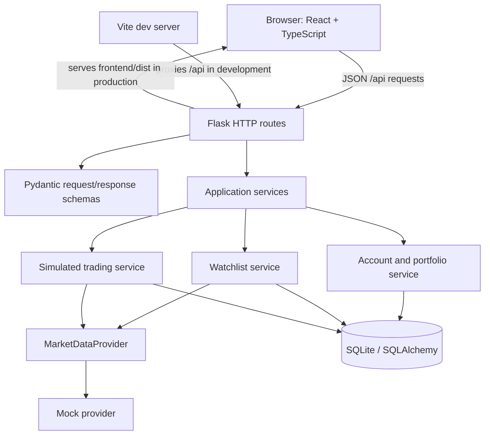

# TradePoint — Architecture and Parallel Development Plan

**Status:** Current architecture guidance. Flask remains the API/backend server; React/Vite is the primary frontend. `CONTRACTS.md` and the generated OpenAPI declarations define the live HTTP API.

## 1. What exists now

The repository is a compact Flask modular backend with a React/Vite frontend:

| Existing file | Current role |
|---|---|
| `app.py` | Flask app factory, API routes, DB/account initialization, and common JSON errors. |
| `services.py` | Search/cache, watchlist add/list/delete, quote mapping. |
| `portfolio_service.py` | Demo-account initialization/read and read-only holdings/portfolio valuation. |
| `trading_service.py` | Idempotent simulated orders, atomic account/holding/cash-ledger updates, and transaction reads. |
| `news_research_service.py` | News pagination/persistence/deduplication, article retrieval, cached summaries, research and contextual conversation orchestration. |
| `news_provider.py`, `llm_provider.py` | Normalized provider Protocols; deterministic local mocks are in `mock_research_providers.py`. |
| `provider.py` | `MarketDataProvider`, normalized `InstrumentData`/`QuoteData`, mock market data, `ProviderUnavailable`. |
| `schemas.py` | Pydantic request/response validation. |
| `models.py` | SQLAlchemy instrument, watchlist, account, holdings, order, transaction, and cash-ledger tables. |
| `database.py` | Shared engine/session and SQLite foreign-key setup. |
| `config.py` | Database URL, demo user ID, secret key. |
| `frontend/src/` | Primary React/TypeScript user interface. Vite serves it in development and builds it to `frontend/dist/` for Flask production serving. |
| `CONTRACTS.md` | Current API and component contracts. |
| `README.md`, `requirements.txt` | Run and dependency instructions. |

The implementation is a single-user demo with persistent SQLite storage and configurable market/news/LLM providers. Account, holdings, watchlist, paper trading, orders, transactions, news, summaries, research, and persistent context-pinned AI conversations are implemented. Authentication and historical market-price APIs are not implemented.

## 2. Recommended architecture: keep the modular monolith

Keep one Flask process, one SQLAlchemy database, one Pydantic API boundary, and the current provider abstraction. Add domain service modules as features arrive; do not introduce microservices, message queues, background workers, CQRS, or a general plugin framework for this scope.

Routes should parse/validate, call a service, and map domain errors to HTTP. Services own business rules and transaction boundaries. SQLAlchemy models persist state. Provider adapters own external market-data translations; they must return normalized application types. React owns display and interaction only. It calls Flask through relative `/api/...` URLs and never accesses the database or provider interfaces directly.

## 3. Proposed future domain boundaries

Add these modules only when the corresponding feature is started. They are logical boundaries, not a demand to split the application into many files immediately.

| Area | Responsibility | Owns state/rules |
|---|---|---|
| Instrument catalog and quotes | Search normalized equities; quote lookup through provider. | Instrument identity and quote freshness/availability semantics. |
| Watchlist | Add/list/remove watched instruments. | Membership only; a watched stock is not an owned holding. |
| Account | Demo account and cash ledger/balance query. | One demo account identity and cash balance source of truth. |
| Simulated trading | Validate and execute buy/sell requests atomically. | Order lifecycle, idempotency, cash/holding checks, transaction records. |
| Portfolio | Read-only aggregation of holdings, prices, valuation, and P/L. | Calculation definitions; should not independently mutate balances. |

Suggested future module names: `services.py` can initially remain for watchlist; when trading/portfolio work begins, create `account_service.py`, `trading_service.py`, and `portfolio_service.py`. Keep `app.py` routes thin. Do not create these files until work begins, to avoid empty abstraction scaffolding.

## 4. Suggested persistence model for future scope

Keep existing `instruments` and `watchlist_entries` as specified in `CONTRACTS.md`. Add tables in feature-specific migrations or a deliberate development database reset; `Base.metadata.create_all()` does not migrate existing schemas.

| Table | Purpose and important constraints/status |
|---|---|
| `accounts` | **Implemented.** Demo account identity, INR currency, and persisted initial cash. Unique account key; no authentication implied. |
| `cash_ledger_entries` | **Implemented.** Append-only cash movements with signed `NUMERIC` amount, entry type, timestamp, idempotency key, and optional order reference. Balance is the sum of opening cash plus ledger deltas. |
| `orders` | **Implemented.** Account/instrument, side, quantity, market type, status, idempotency key, execution price/rejection reason, timestamp. Unique `(account_id, idempotency_key)`. |
| `transactions` | **Implemented.** Immutable completed fill facts: unique order, instrument, side, quantity, price, gross amount, timestamp. Rejected orders have no transaction. |
| `news_articles` | **Implemented.** Normalized article metadata/content with unique canonical URL and unique `(source, provider_article_id)`. Symbols are stored as JSON. |
| `article_summaries` | **Implemented.** One structured cached AI summary per article. |
| `ai_conversations`, `ai_conversation_messages`, `ai_conversation_exchanges` | **Implemented.** Pinned context, ordered persisted turns, provider metadata, and globally unique request IDs for idempotent exchanges. These are additive tables created by `create_all()`. |
| `holdings` | **Implemented foundation.** Account/instrument, positive whole-share quantity, average purchase price, realized P/L. No trading service mutates it yet. When trading is implemented, define transactions as source of truth and holdings as a transactionally updated projection. |
| `watchlist_entries` | Existing membership table; do not infer ownership from membership. |

Use `Decimal` in Python and SQL `NUMERIC` for money and share quantities; never use float. Ensure serialized API money follows a single chosen string format (recommend fixed two-decimal strings for INR amounts, consistent with `CONTRACTS.md`). Quantities need a separately chosen decimal scale if fractional shares are supported; do not assume integer shares until decided.

### Trading transaction boundary

A simulated market/limit execution must be one SQLAlchemy transaction: validate request and idempotency key; read account/cash and holding state; validate sufficient cash/quantity; create/transition order; create trade/fill; append cash ledger; update holding projection if used; commit. On any failure, roll back all writes. Repeated idempotency keys return the original result and must not execute twice. SQLite concurrency should be treated carefully; use an explicit write transaction/locking strategy or serialize writes in the application. The exact approach should be proven under concurrent requests before multi-user use.

Conversation message writes reserve SQLite's writer before transcript reads (`BEGIN IMMEDIATE`), call the LLM while holding that reservation, and atomically save both messages plus a `ai_conversation_exchanges` idempotency row. A UUID request ID is globally unique. Replays with the same conversation and content return the stored conversation without another generation; reuse with different content or conversation is a 409 conflict. SQLite's 45-second busy timeout also applies to competing writers, so long provider requests can delay unrelated writes.

## 5. API growth rules

Keep existing four watchlist routes and response bodies unchanged unless an intentional breaking contract revision is approved. Future endpoint groups should be additive and described in Pydantic schemas before independent implementation. Suggested resource boundaries (names are proposals, not finalized schemas):

- `GET /api/account`: implemented account summary and available cash.
- `GET /api/portfolio`: implemented holdings plus valuation/P&L summary.
- `POST /api/orders`, `GET /api/orders`, and `GET /api/orders/{order_id}`: implemented submit/retrieve/history.
- `GET /api/transactions`: implemented fill history.
- `GET /api/news`: implemented personal or general market feed with provider cursor pagination.
- `GET /api/news/{article_id}` and `POST /api/news/{article_id}/summary`: implemented metadata/content retrieval and cached structured summary.
- `POST /api/research/suggestions`: implemented symbol-specific mock-backed orchestration with article evidence IDs.
- Watchlist: existing routes.

Before coding each group, define exact JSON field names/types, Decimal wire serialization, nullable quote semantics, status enum values/transitions, error codes/statuses, idempotency behavior, and service signatures. Keep `instrument_token` internal or public consistently with the existing approved contract. Use the common error envelope already established in `CONTRACTS.md` for all APIs.

## 6. Resolved initial simulated-trading decisions

These are the implemented MVP trading rules. They are intentionally simple and do not introduce broker execution.

1. **Order type:** `MARKET` only. Limit orders and cancellation are out of scope.
2. **Execution:** Execute immediately using the available positive quote returned during submission. The quote may be simulated (`simulated=true`) or live (`simulated=false`); this flag describes quote provenance, not the order's execution mode. Both outcomes are recorded only in TradePoint's internal paper account. A missing quote, provider outage, or quote that rounds to zero rejects the paper order; no broker order is submitted.
3. **Costs:** INR, no fees/taxes/slippage in this MVP. Round monetary values to two decimals using decimal half-up; reject a quote that rounds to zero.
4. **Quantity:** Positive whole shares, integer quantity, maximum 100,000 per order. Fractional shares are unsupported.
5. **Cash:** One demo account, starting cash INR 1,000,000.00, configured/reset only through development setup; no deposit/withdrawal API. Available cash equals ledger-derived cash because orders execute immediately and none remain pending.
6. **Holdings:** Completed transactions are immutable; the persisted holdings row is the current projection updated atomically with each transaction. Average cost uses weighted average with six internal decimal places; API monetary values remain two-decimal INR strings. Selling reduces average-cost inventory and realized P/L is `(sell price - average cost) * sold quantity`. Unrealized P/L is `(latest price - average cost) * current quantity`.
7. **Buy/sell:** Buy requires enough cash for gross amount; sell requires enough owned whole shares. Rejected attempts create a `REJECTED` order record with no trade and no cash/holding mutation. Accepted attempts create one `FILLED` order and exactly one transaction/fill.
8. **Statuses:** `FILLED` and `REJECTED` only. No `PENDING` state under synchronous immediate-fill behavior.
9. **Idempotency:** Client supplies a nonempty idempotency key (1–128 chars), unique per demo account for the lifetime of the order. A repeated key with same canonical request returns the stored order result; same key with different request returns conflict and does not mutate state.
10. **Atomicity/concurrency:** Order, transaction, and cash-ledger changes commit in one DB transaction. Any unexpected failure rolls back all writes. Serialize SQLite write transactions; concurrency guarantees are for one local process only. Do not claim multi-process/multi-user safety.
11. **Money/JSON:** Python `Decimal`, SQLite `NUMERIC`, INR; API money is a string with exactly two decimal places. Order request/response quantities are JSON integers; aggregated holdings/transaction quantities are canonical base-10 integer strings. Never use binary float for calculations.
12. **Account identity:** Keep `TRADEPOINT_DEMO_USER_ID`; no auth or multiple-user feature in this phase.

The original source brief was truncated after “Trading will initially use simulated”. The rules above document the implemented MVP behavior; they should not be interpreted as a commitment to real broker execution.

## 7. Machine-checkable contract foundation

`schemas.py` is the shared source for Pydantic API structures. `scripts/export_openapi.py` emits `openapi.json` for implemented watchlist, account, portfolio, trading, news, summarization, and research routes.

`npm run contracts:types` regenerates `openapi.json` and `static/api-types.d.ts` intentionally. Do not hand-edit generated files. `npm run check` compares committed generated artifacts with fresh output without writing them, then runs Python contract tests. CI also installs the frontend lockfile, builds React, runs frontend API fixture tests and lint, and smoke-tests Flask serving the production assets. React API types are imported from the generated OpenAPI declaration; the runtime API client validates response shapes before returning them.

Normalized integration seams are `MarketDataProvider` in `provider.py`, `NewsProvider` in `news_provider.py`, and `LLMProvider` in `llm_provider.py`. Application services are explicit module-level functions (`services.py`, `portfolio_service.py`, `trading_service.py`, and `news_research_service.py`), called directly by Flask routes with dependencies passed as arguments. Deterministic mock providers and backend orchestration are implemented. Groq, Hugging Face, and Ollama LLM adapters are present; the runtime selects Groq by default outside tests. React is the primary frontend.

## 8. Remaining decisions

1. Obtain and review the omitted remainder of the product brief after “Trading will initially use simulated” before starting any trading implementation.
2. Confirm the starting cash amount and development reset mechanism; this plan assumes INR 1,000,000.00 and no API for funding.
3. The current simulated execution accepts any available quote, including live-provider quotes, while keeping all orders and transactions in TradePoint's paper ledger. Define acceptable quote age once there is more than one provider.
4. Select news source(s), licensing/retention rules, and article text availability before implementing NewsProvider.
5. Configure an LLM provider/model, privacy/retention policy, token budget and safety constraints before deployment. The current Flask runtime defaults to Groq outside tests; `.env.local` is loaded for local development and deployment hosts provide credentials through server-side environment configuration.
6. Define the required human review/disclaimer behavior and allowed scope of AI suggestions before exposing research endpoints.
7. SQLite remains the MVP database. Conversation turns use SQLite's cross-process writer reservation; this serializes all writes during LLM generation and is suitable only for the current low-volume demo. Measure contention before supporting broader multi-user traffic or moving to a server database.

## 9. Integration contract workflow

For each feature, complete this sequence before assigning parallel work:

1. Write/update the relevant section of `CONTRACTS.md` with wire schemas, service signatures, persistence constraints, and errors.
2. Define shared Python models and enums first, or provide exact stubs/types all agents can import.
3. Assign work by stable boundaries: browser UI, provider adapter, and backend/domain implementation.
4. Agree which owner may change shared files; avoid simultaneous edits to `app.py`, `schemas.py`, `models.py`, and `requirements.txt`.
5. Require each agent to report contract assumptions and changed files. Integrator checks names/types/status values against the contract before merge.
6. Add tests at boundaries: provider conformance, service/database transaction behavior, route request/response schemas, and frontend request parsing. Tests should use isolated temporary SQLite databases and deterministic provider fixtures.

## 10. Three-person ownership proposal

This split preserves independent work while keeping integration surfaces explicit:

| Developer | Primary ownership | Must coordinate on |
|---|---|---|
| A — Frontend | `frontend/src/`, `frontend/package.json`. | `CONTRACTS.md`/OpenAPI response shapes, enum/status labels, errors, and money formatting. No direct DB/provider imports. |
| B — Market data | `provider.py`; future `providers/` adapter modules if a real adapter is authorized. | `InstrumentData`, `QuoteData`, `MarketDataProvider`, `ProviderUnavailable`. Do not alter HTTP shapes or DB models independently. |
| C — Backend/domain integration | `app.py`, `services.py`, `schemas.py`, `models.py`, `database.py`, `config.py`; future account/trading/portfolio services and route modules. | All shared schemas and database migrations. Owns transaction integration and must align with provider owner’s normalized types. |

**Shared/review-required:** `CONTRACTS.md` (authoritative; every boundary change recorded), `requirements.txt` (dependency changes), and `README.md` (run instructions). Database migrations are also shared review artifacts because they affect existing `tradepoint.db` data. Developer C should not unilaterally add breaking watchlist fields while A or B implements against the contract.

Avoid assigning different owners to `app.py`, `schemas.py`, and `models.py` in the same milestone: those files define central integration surfaces. If backend workload grows, split only after adding stable module interfaces and then assign entire feature domains, not arbitrary individual files.

## 11. Repository and delivery rules

- Preserve existing watchlist behavior and its contracts as the baseline.
- Do not build the complete planned product in one change. Deliver one vertical slice at a time: schema/DB/service/API/UI with tests.
- Do not add real Kite credentials or real trading. Provider replacement does not imply order execution integration.
- Do not assume `create_all()` upgrades databases; decide migrations or an explicit local reset before schema changes.
- Keep simulated prices visibly marked as simulated; do not call them live/current exchange prices.
- Use deterministic mock fixtures in tests and keep provider-specific response mapping inside the adapter.
- Keep this document and `CONTRACTS.md` aligned; if they conflict on current watchlist APIs, `CONTRACTS.md` is authoritative until amended.

## 12. Frontend runtime and verification

- **Development:** start Flask with `py app.py` on port 5000, then run `npm run frontend:dev`; Vite serves React on port 5173 and proxies `/api/*` to Flask. The Vite config owns this development proxy.
- **Production:** run `npm run frontend:build` to create `frontend/dist/`, then run `waitress-serve --call --listen=0.0.0.0:5000 app:create_app`. Flask serves the build at `/` and static files from the same build directory. If the build is absent, `/` returns an actionable 503 response. React is the sole frontend.
- **API traffic:** the React client always calls relative `/api/...` routes. Vite forwards them during development; in production the browser calls Flask directly on the same origin.
- **Merge verification:** after installing root and frontend npm lockfiles plus Python requirements, run `npm run frontend:build`, `npm run check`, `npm run frontend:test`, `npm run frontend:lint`, and `py scripts/check_frontend_runtime.py`. GitHub Actions runs all five checks.

## 13. Current implementation status

The watchlist, account/portfolio, simulated trading, news/article, summaries, research, and context-pinned multi-turn conversation APIs are implemented. The React frontend consumes those APIs; historical charting remains unavailable. The Markets view uses stock search and watchlist quote data. The order ticket is embedded in the dashboard and quick-order modal. Flask unconditionally serves the React production build; the Vite development server proxies API calls to Flask. Production provider adapters are documented in provider modules.

## 14. Ready-to-use developer task briefs

### Developer 1 — Backend and architecture

> Implement the next assigned backend vertical slice in the existing Flask/SQLAlchemy/Pydantic modular monolith. Read `CONTRACTS.md`, `ARCHITECTURE.md`, `openapi.json`, and shared schemas first. Do not change watchlist wire behavior. Add or update Pydantic models, direct service functions with explicit dependencies, route handling, persistence constraints/migration plan, and contract/integration tests for your assigned feature. Keep money as `Decimal` internally and fixed two-decimal strings on the wire; use the common `ErrorResponse`. Do not implement unrelated domains. Run `npm run check`. If the contract is insufficient, propose a contract change before coding against a different shape.

### Developer 2 — Frontend

> Implement the assigned UI slice in the existing React/TypeScript/Vite app under `frontend/src/`. Use types from `static/api-types.d.ts` and the corresponding schemas in `schemas.py`; do not invent payload fields or convert monetary strings to floating-point values. Use only relative Flask `/api` calls, render provider/AI text safely, and handle the shared error envelope. Preserve existing watchlist interactions. Add/update API fixture tests when needed. Do not call market-data, news, or LLM providers directly. Run `npm run frontend:build`, `npm run frontend:test`, and `npm run frontend:lint`, then report API assumptions.

### Developer 3 — External integrations

> Implement only the assigned provider adapter behind its existing Protocol (`MarketDataProvider`, `NewsProvider`, or `LLMProvider`). Do not change Flask routes, public API schemas, SQLAlchemy models, or frontend behavior. Return normalized application objects, translate provider-specific payloads/errors inside the adapter, and use explicit typed unavailable errors. Provide deterministic fake implementations for tests and conformance tests for the Protocol. Do not add real trading execution or credentials unless separately authorized. Run `npm run check` and list any provider limitation that affects the contract.

### Merge gate

The shared branch requires the full workflow in section 12 to pass. Changes to `schemas.py`, provider Protocols, OpenAPI generation, generated types, database schema, `CONTRACTS.md`, or this architecture plan require central integrator review. Generated `openapi.json` and `static/api-types.d.ts` must be regenerated in the same change as schema edits. Never hand-edit generated artifacts.
