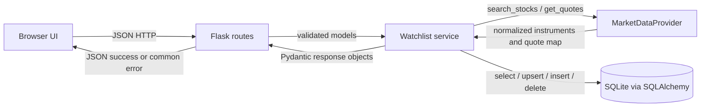

# TradePoint — Current Implementation Contracts

**Purpose:** This document records the behavior currently implemented by the repository. `schemas.py`, Flask routes, services, models, providers, and generated OpenAPI define the implementation; this document explains their shared interfaces. Update the implementation, OpenAPI, and generated frontend declarations together when changing a contract.

## Decision status

The decisions below describe the current MVP. Any future breaking change should be agreed by the owners of the affected boundary and reflected in this document and generated artifacts.

### Resolved decisions

1. Keep Flask, SQLAlchemy, SQLite, Pydantic, the current service/provider split, and the implemented JSON API routes listed below.
2. Search provider data, accept only `exchange == "NSE"` and `instrument_type == "EQ"`, and upsert eligible results into the local `instruments` table. Add first checks for an eligible cached symbol; if absent, it searches the provider by exact symbol, verifies the returned eligible NSE equity, stores it, then adds it.
3. Provider `get_quotes` is a batch interface and service code uses it in batches: one instrument on add, all watchlist instruments in one call on GET. Missing keys mean no quote. A provider exception makes all quote(s) in that call unavailable; saved membership remains unaffected.
4. Serialize prices as **JSON strings** containing a nonnegative decimal with exactly two fractional digits, e.g. `"3865.25"`. This preserves decimal precision and avoids JavaScript number rounding. Frontend displays the string as supplied. Price is strictly positive for available quotes.
5. Quote fields are `price`, `currency`, `as_of`, `simulated`. `as_of` is an ISO 8601 UTC string. `simulated` describes quote provenance: true for mock/simulated prices, false for live-provider prices. A missing quote is `null`.
6. All API errors, including Flask 404, 405, and unexpected 500 errors, use the same JSON envelope. Validation messages are stable and concise, not raw Pydantic exception text.
7. New add returns 201; duplicate add returns 200 and the existing item. Deleting absent membership returns 404. No quote is persisted.
8. Keep one configured demo user and no authentication/user table in this milestone.
9. Keep `instrument_token` in the public stock response for now because it is already present in the current API and supports provider lookup. It is an opaque positive integer, not a client-generated value.

## 1. Component responsibilities and flow

| Component | Responsibility |
|---|---|
| Browser / React application | Send JSON requests, display stocks and portfolio/news data, and submit user actions. It does not call providers or access the DB. |
| Flask routes / `app.py` | HTTP parsing, request schema validation, call service functions, map known errors to HTTP status and response schema. No business logic or provider-specific fields. |
| Pydantic / `schemas.py` | Validate request and response structures at API boundary, with strict extra-field rejection. |
| Services / `services.py` | Search/upsert instruments, add/list/remove watchlist membership, batch quote requests, convert DB/provider objects to API models. |
| Provider / `provider.py` | Implement normalized search and quote interface. Mock or future Kite adapter owns provider-specific mapping. |
| News provider / `news_provider.py` | Return normalized article pages and details; provider-specific mapping stays in the adapter. |
| LLM provider / `llm_provider.py` | Return structured summary and research drafts; it does not persist or mutate domain state. |
| News/research service / `news_research_service.py` | Associate, deduplicate, and persist news; orchestrate summaries/research and attach evidence IDs. |
| SQLAlchemy / `models.py`, `database.py` | Store normalized instruments and watchlist membership. Never store current quote prices. |



## 2. API contract

All API requests/responses use `application/json`, except `GET /` which returns HTML. Unknown JSON keys are rejected. JSON response keys and types below are exact. `as_of` is UTC RFC 3339 / ISO 8601 ending in `Z`. `price` is a string, never a JSON number.

### `POST /api/stocks/search`

Request body:

```json
{"query":"Tata","limit":20}
```

`query`: string, trim whitespace, 1–100 characters after trim. `limit`: integer 1–100, defaults to 20. Search matching/ranking is provider-defined (the mock uses case-insensitive substring matching on symbol/name). Results are restricted to instruments whose exchange is exactly `NSE` and type exactly `EQ`. Empty results are successful. Eligible results are upserted into the local instrument cache before responding. Startup seeding applies the same filter.

200:

```json
{"results":[{"symbol":"TCS","name":"Tata Consultancy Services","exchange":"NSE","instrument_token":123}]}
```

`results` is an array; `symbol`, `name` strings; `exchange` exactly `"NSE"`; `instrument_token` positive integer.

Errors: 400 `VALIDATION_ERROR`; 503 `PROVIDER_UNAVAILABLE` if provider search fails; 500 `INTERNAL_ERROR` for DB/unexpected failure.

### `POST /api/watchlist`

Request:

```json
{"symbol":"TCS"}
```

`symbol`: string, trim and uppercase, 1–32 characters after trim. Resolve exact eligible NSE equity symbol from local cache. If absent, call provider search using that symbol, then accept only an exact uppercase match with exchange `NSE` and instrument type `EQ`; upsert the instrument. If no exact eligible match, return 404. This makes add work even if the browser’s prior search result was not cached or cache was empty.

201 new / 200 duplicate:

```json
{"item":{"stock":{"symbol":"TCS","name":"Tata Consultancy Services","exchange":"NSE","instrument_token":123},"quote":{"price":"3865.25","currency":"INR","as_of":"2026-11-07T10:30:00Z","simulated":true}},"created":true}
```

`created` is boolean. `quote` is either the quote object or `null`. A quote failure does not roll back or hide the saved entry. Duplicate addition does not create a second row and returns `created:false`.

Errors: 400 `VALIDATION_ERROR`; 404 `STOCK_NOT_FOUND`; 503 `PROVIDER_UNAVAILABLE` only when provider search is needed and fails before an instrument can be resolved; 500 `INTERNAL_ERROR` for DB/unexpected failure. If the stock is already resolved and quote retrieval fails, return success with null quote.

### `GET /api/watchlist`

No request body or parameters. Query all configured demo user’s items, then call `get_quotes` once with the complete instrument list. Empty list skips provider call.

200:

```json
{"items":[{"stock":{"symbol":"TCS","name":"Tata Consultancy Services","exchange":"NSE","instrument_token":123},"quote":{"price":"3865.25","currency":"INR","as_of":"2026-11-07T10:30:00Z","simulated":true}}]}
```

`items` is ordered by `created_at`, then symbol. Each quote may be `null`. Provider exception or absent quote key produces null quote(s), while returning all saved stock entries. DB/unexpected failures return 500 common error.

### `DELETE /api/watchlist/{symbol}`

Path symbol is URL-decoded by Flask, trimmed and uppercased; valid length 1–32. No body.

200: `{"symbol":"TCS","deleted":true}`.

Errors: 400 `VALIDATION_ERROR` for blank/too-long symbol; 404 `WATCHLIST_ITEM_NOT_FOUND` if not in this demo user’s watchlist; 500 `INTERNAL_ERROR` for DB/unexpected failure.

## 3. Pydantic/API data models

These are the implemented model-level types and rules. All request models reject extras.

| Structure | Exact fields |
|---|---|
| `SearchRequest` | `query: str` (trimmed, 1–100); `limit: int = 20` (1–100). |
| `AddWatchlistRequest` | `symbol: str` (trimmed, uppercase, 1–32). |
| `StockSummary` | `symbol: str`; `name: str`; `exchange: Literal["NSE"]`; `instrument_token: int > 0`. |
| `Quote` | `price: str` (positive decimal string, exactly 2 fractional digits); `currency: Literal["INR"]`; `as_of: datetime` normalized to UTC and serialized with `Z`; `simulated: bool`. |
| `WatchlistItem` | `stock: StockSummary`; `quote: Quote \| None` (required key, null permitted). |
| Search response | `results: list[StockSummary]`. |
| Add response | `item: WatchlistItem`; `created: bool`. |
| List response | `items: list[WatchlistItem]`. |
| Delete response | `symbol: str`; `deleted: Literal[true]`. |
| Error response | `error: {code: str, message: str, field: str \| null}`. |

Prices and monetary amounts are validated and serialized as strings with two fractional digits. The frontend must not parse them into JavaScript `Number` for display.

## 4. Internal service contracts

Function inputs and outputs below are the current service boundary. Flask route/caller owns the `Session` lifetime; service functions do not open global sessions.

| Function | Input | Output | Failure contract |
|---|---|---|---|
| `seed_instruments(session, provider) -> None` | SQLAlchemy `Session`, `MarketDataProvider` | Seed normalized provider catalog when cache empty. | Provider/DB failure propagates to app startup; log and fail startup rather than run with silently empty cache. Refresh policy remains out of scope. |
| `search(session, provider, query: str, limit: int) -> list[StockSummary]` | Validated query and limit | Provider matches, upsert cache, return canonical rows. | `ProviderUnavailable` or DB exception. |
| `add(session, provider, user_id: str, symbol: str) -> tuple[WatchlistItem, bool]` | User ID and normalized symbol | Resolve cache or exact provider match, upsert, ensure unique membership, quote one instrument, return item and created flag. | `StockNotFound`; provider unavailable only when provider search is required; DB exception. Quote failure returns null quote, not exception. Handle uniqueness race by re-reading duplicate row and returning `created=False`. |
| `list_items(session, provider, user_id: str) -> list[WatchlistItem]` | User ID | Load ordered entries, call provider once with all instruments, map quote keys to items; absent map entries / provider failure => null quotes. | DB/unexpected mapping failure propagates. |
| `remove(session, user_id: str, symbol: str) -> None` | User ID and normalized symbol | Delete matching membership. | `WatchlistItemNotFound`; DB exception. |

Other current module-level service signatures are: `portfolio_service.get_account(session, account_id) -> AccountSummary`; `portfolio_service.get_portfolio(session, provider, account_id) -> PortfolioSummary`; `trading_service.place_order(session, provider, account_id, request) -> tuple[OrderResponse, bool]`, `get_order(session, account_id, order_id) -> OrderResponse`, `list_orders(session, account_id) -> list[OrderResponse]`, and `list_transactions(session, account_id) -> list[Transaction]`; `news_research_service.search_news(session, provider, account_id, request) -> NewsSearchResponse`, `get_article(session, provider, article_id) -> NewsArticle`, `summarize_article(session, news_provider, llm, article_id) -> SummaryResponse`, and `research_stock(session, news_provider, llm, market_provider, request) -> ResearchResponse`. Routes own and close sessions. Services are called directly as functions; there are no service objects or service Protocols.

Use explicit domain exceptions `StockNotFound`, `WatchlistItemNotFound`, `ProviderUnavailable`. Do not leak exception text or stack traces into HTTP responses. Log unexpected exceptions server-side.

## 5. Provider interface

The interface is application-owned; implementations return normalized TradePoint data, never raw Kite structures.

```python
@dataclass(frozen=True)
class InstrumentData:
    exchange: str              # "NSE" for supported results
    symbol: str
    name: str
    instrument_token: int      # positive integer
    instrument_type: str       # normalized category; only "EQ" is eligible

@dataclass(frozen=True)
class QuoteData:
    price: Decimal             # positive INR amount
    as_of: datetime            # timezone-aware UTC instant
    simulated: bool            # true for mock, false for live provider

class MarketDataProvider(Protocol):
    def search_stocks(self, query: str, limit: int = 20) -> list[InstrumentData]: ...
    def get_quotes(
        self, instruments: list[InstrumentData]
    ) -> dict[tuple[str, str], QuoteData]: ...  # key is (exchange, symbol)
```

One `get_quotes` call must accept any list, including one element, and return zero or more keys from that list. Unknown/missing quote keys are normal. A quote with `simulated=False` is valid data for watchlist, portfolio, research context, and simulated order pricing. Operational failures raise `ProviderUnavailable` (or are translated to it at adapter boundary). `search_stocks` raises the same typed exception for provider outages. Provider-specific fields and Kite mappings stay inside the adapter. Mock values remain visibly simulated. At startup, when the instrument cache is empty, `create_app` calls `search_stocks("", 100)` to seed it; provider implementations must support this bounded catalog request.

**Usage rule:** `add` calls `get_quotes([selected_instrument])` once. `list_items` calls `get_quotes(all_watchlist_instruments)` once, not once per row. Both map by `(exchange, symbol)`.

## 6. Database contract

Retain the current tables and constraints:

| Table | Fields and constraints |
|---|---|
| `instruments` | `id INTEGER PRIMARY KEY`; `exchange VARCHAR(8) NOT NULL`; `symbol VARCHAR(32) NOT NULL`; `name VARCHAR(160) NOT NULL`; `instrument_token BIGINT NOT NULL UNIQUE`; `instrument_type VARCHAR(16) NOT NULL`; unique `(exchange, symbol)`. |
| `watchlist_entries` | `id INTEGER PRIMARY KEY`; `user_id VARCHAR(128) NOT NULL`; `instrument_id INTEGER NOT NULL REFERENCES instruments(id) ON DELETE RESTRICT`; `created_at DATETIME NOT NULL DEFAULT current timestamp`; unique `(user_id, instrument_id)`. |

Enable SQLite foreign keys on every connection. No ORM relationship property is required by this contract. Do not add quote columns. Continue using `TRADEPOINT_DATABASE_URL` and `TRADEPOINT_DEMO_USER_ID` (default `demo-user`). Token global uniqueness is retained for this milestone; verify provider catalog compatibility before changing it.

Cache writes are upserts by `(exchange, symbol)`: update name, token, and type when an existing instrument is found. Any token uniqueness conflict for a different symbol is a data-integrity error and must not silently overwrite another instrument.

## 7. Standard error contract

Every API failure, including unknown route, unsupported method, bad content type, malformed JSON, provider failure, DB failure, and unexpected exception, returns `application/json` with:

```json
{"error":{"code":"STOCK_NOT_FOUND","message":"No matching NSE equity was found.","field":"symbol"}}
```

`field` is null when no single request field caused the failure. `message` is short and stable; Pydantic internals and stack traces are server-only. Flask HTTP exception handlers should translate framework 404/405 to `NOT_FOUND` / `METHOD_NOT_ALLOWED` in this shape.

| HTTP | Code | Use |
|---|---|---|
| 400 | `VALIDATION_ERROR` | Invalid JSON, wrong content type, unknown keys, invalid field or path. |
| 404 | `STOCK_NOT_FOUND` | Add symbol cannot be resolved to an exact NSE equity. |
| 404 | `WATCHLIST_ITEM_NOT_FOUND` | Delete target is not saved. |
| 404 | `NOT_FOUND` | Unknown API path. |
| 405 | `METHOD_NOT_ALLOWED` | Known path with unsupported method. |
| 503 | `PROVIDER_UNAVAILABLE` | Required search operation cannot reach provider. Quote outages are partial success with null quote. |
| 500 | `INTERNAL_ERROR` | Database or unexpected server failure. |

Other endpoint-specific codes are `ARTICLE_NOT_FOUND` (404), `ORDER_NOT_FOUND` (404), `CONVERSATION_NOT_FOUND` (404), `IDEMPOTENCY_CONFLICT` (409), `MESSAGE_IDEMPOTENCY_CONFLICT` (409), `ARTICLE_CONTENT_UNAVAILABLE` (422), `NEWS_PROVIDER_UNAVAILABLE` (503), and `LLM_PROVIDER_UNAVAILABLE` (503). Business order rejections (`INSUFFICIENT_CASH`, `INSUFFICIENT_SHARES`, `QUOTE_UNAVAILABLE`) are successful order representations with status `REJECTED`, not HTTP errors. Every live API operation can also return `METHOD_NOT_ALLOWED` (405) for an unsupported method and `INTERNAL_ERROR` (500); unknown API paths return `NOT_FOUND` (404). All use `ErrorResponse`.

| Live operation | Endpoint-specific errors |
|---|---|
| `POST /api/stocks/search` | 400 `VALIDATION_ERROR`; 503 `PROVIDER_UNAVAILABLE` |
| `GET /api/watchlist` | Common errors only |
| `POST /api/watchlist` | 400 `VALIDATION_ERROR`; 404 `STOCK_NOT_FOUND`; 503 `PROVIDER_UNAVAILABLE` when uncached resolution is needed |
| `DELETE /api/watchlist/{symbol}` | 400 `VALIDATION_ERROR`; 404 `WATCHLIST_ITEM_NOT_FOUND` |
| `GET /api/account`, `GET /api/portfolio` | Common errors only |
| `POST /api/orders` | 400 `VALIDATION_ERROR`; 404 `STOCK_NOT_FOUND`; 409 `IDEMPOTENCY_CONFLICT` |
| `GET /api/orders` | Common errors only |
| `GET /api/orders/{order_id}` | 404 `ORDER_NOT_FOUND` |
| `GET /api/transactions` | Common errors only |
| `GET /api/news` | 400 `VALIDATION_ERROR`; 503 `NEWS_PROVIDER_UNAVAILABLE` |
| `GET /api/news/{article_id}` | 404 `ARTICLE_NOT_FOUND` |
| `POST /api/news/{article_id}/summary` | 404 `ARTICLE_NOT_FOUND`; 422 `ARTICLE_CONTENT_UNAVAILABLE`; 503 `LLM_PROVIDER_UNAVAILABLE` |
| `POST /api/research/suggestions` | 400 `VALIDATION_ERROR`; 404 `STOCK_NOT_FOUND`; 503 `NEWS_PROVIDER_UNAVAILABLE` or `LLM_PROVIDER_UNAVAILABLE` |

Validation error examples must be deterministic, e.g. `{"error":{"code":"VALIDATION_ERROR","message":"query must not be empty","field":"query"}}`. Do not expose raw Pydantic error dumps.

## 8. Frontend contract

- The primary frontend is React/TypeScript under `frontend/src/`, built and served by Vite during development and by Flask in production. Public API types are imported from the generated `static/api-types.d.ts`; the API client validates decoded JSON before returning typed data.
- Search sends `POST /api/stocks/search` `{query: string, limit: 20}`; reads `results[]` and uses `name`, `symbol`.
- Selecting a result sends `POST /api/watchlist` `{symbol: string}`; treats both 200 and 201 as success; reads `item` if needed and refreshes via GET.
- Initial load and refresh send `GET /api/watchlist`; reads `items[]`, each containing `stock` and nullable `quote`.
- Price is rendered as the supplied decimal string plus currency; do not convert to JS number. `simulated:true` displays “Simulated quote”; false may display “Quote available”. Null displays “Unavailable”.
- Remove sends `DELETE /api/watchlist/{encoded symbol}`; on 200 refreshes list.
- For any non-2xx response, parse common error envelope and display `error.message`; malformed/non-JSON network responses get a generic client fallback.
- Continue safe DOM insertion with `textContent`; no page reload required.

The React app also consumes `GET /api/account`, `GET /api/portfolio`, `POST /api/orders`, `GET /api/orders`, `GET /api/transactions`, `GET /api/news`, `GET /api/news/{article_id}`, `POST /api/news/{article_id}/summary`, `POST /api/research/suggestions`, and the conversation endpoints below. It uses the exact response fields and nullable behavior specified in this document and `openapi.json`. Daily P&L, portfolio performance history, standalone market quotes/history, and other unsupported data are explicit placeholders because no corresponding API fields or routes exist.

The React Markets view searches with `POST /api/stocks/search`. The backend has no standalone quote endpoint, so the view displays a quote only when the searched symbol is already in the watchlist response from `GET /api/watchlist`. Adding a result uses the existing `POST /api/watchlist` operation, after which the page refreshes the watchlist quote. Historical charts remain unavailable because no historical-price route exists. Paper trading continues to use the existing order ticket in the dashboard and quick-order modal.

### Frontend runtime

- **Development:** run Flask (`py app.py`, port 5000) and Vite (`npm run frontend:dev`, port 5173) in separate terminals. Vite proxies `/api/*` to `http://127.0.0.1:5000`; the React client uses relative `/api/...` paths.
- **Production build:** `npm run frontend:build` creates `frontend/dist/index.html` and `frontend/dist/assets/*`.
- **Production server:** run `npm run frontend:build`, then start the WSGI app with `waitress-serve --call --listen=0.0.0.0:5000 app:create_app`. Flask serves the built React entry point and files from `frontend/dist/`; the same-origin `/api` paths continue to use the existing Flask routes. If the build is missing, `/` returns an actionable 503 response instructing the operator to build the frontend. React is the only frontend.
- **Verification:** `npm run frontend:build`, `npm run check`, `npm run frontend:test`, `npm run frontend:lint`, and `py scripts/check_frontend_runtime.py`. CI runs these checks after installing the root and frontend lockfiles and Python requirements.

## 9. Implementation status

The watchlist, account/portfolio read APIs, simulated order and transaction APIs, news feed/article retrieval, cached AI summaries, stock research suggestions, and contextual conversations are implemented. Market and news providers default to deterministic mocks; the LLM uses Groq by default outside tests and can be injected through `create_app`. The Groq adapter uses the configured model and returns `LLM_PROVIDER_UNAVAILABLE` through the existing error envelope if credentials, the model, or the provider API are unavailable. Composite, mock, and heuristic modes must be explicitly selected; composite fallback results expose the provider that actually generated them. The React frontend connects available APIs; chart history, daily P&L, and standalone quote information remain placeholders. OpenAPI and TypeScript declarations cover the live HTTP API. `npm run check` verifies committed generated artifacts and backend tests without rewriting them; the frontend build, API fixture tests, lint, and Flask production-serving smoke check are separate commands run by CI. Run `npm run contracts:types` only when intentionally regenerating artifacts after an agreed contract change.

## 10. Module ownership boundaries

| Area | Primary modules | Boundary |
|---|---|---|
| Primary browser UI | `frontend/src/`, `frontend/package.json` | React/Vite calls Flask `/api` endpoints; its public types derive from `static/api-types.d.ts`. It does not call providers or access the database. |
| HTTP and validation | `app.py`, `schemas.py` | Routes parse requests, validate with Pydantic, call services, and serialize common errors. |
| Domain orchestration | `services.py`, `portfolio_service.py`, `trading_service.py`, `news_research_service.py` | Module-level functions receive sessions/providers explicitly and return Pydantic models or raise domain/provider exceptions. |
| Persistence | `models.py`, `database.py` | SQLAlchemy schema and engine/session setup. |
| External data adapters | `provider.py`, `news_provider.py`, `llm_provider.py`, mock modules | Implement normalized provider Protocols; provider-specific mapping stays in adapters. |
| API artifacts | `scripts/export_openapi.py`, `openapi.json`, `static/api-types.d.ts` | Pydantic schemas and route declarations generate OpenAPI; TypeScript types derive from OpenAPI. CI checks freshness without rewriting files. |

**Shared contracts:** Changes to `schemas.py`, `scripts/export_openapi.py`, `openapi.json`, or `static/api-types.d.ts` affect multiple components and must be coordinated. Changes to provider Protocols require adapter and service-owner coordination. Route/service/database changes are coupled and should be reviewed together. This document is the human-readable contract; generated artifacts are the machine-checkable HTTP boundary.

## 11. Remaining uncertainties

These remain outside the current MVP contract:

1. Search ranking and tie-breaking beyond provider order. The mock keeps catalog order; no ranking guarantee is needed for MVP.
2. Instrument cache refresh cadence. Current milestone seeds an empty cache and upserts search/add results; periodic refresh is out of scope.
3. Quote timeout/retry policy and provider rate limits. For now adapter must use bounded timeouts; exact values can be chosen in provider implementation and documented there.
4. Whether public clients ultimately need `instrument_token`. Keep it for compatibility in this milestone; revisiting is a versioned API decision.
5. Any future authentication/multiple users or live Kite credentials. Both are explicitly outside this milestone.

**Resolved trading decision:** Any available quote, including `simulated=False`, may supply the execution price. Execution always updates TradePoint's internal paper account; the application never submits a broker order. The quote's `simulated` flag describes quote provenance, not whether the account transaction is simulated.

## 12. Account and portfolio read APIs (implemented)

This additive slice preserves all watchlist routes and response structures.

### `GET /api/account`

No request body. Returns HTTP 200:

```json
{"account_id":"demo-user","currency":"INR","cash_balance":"1000000.00"}
```

`account_id` is the configured demo user ID; `currency` is `INR`; `cash_balance` is a nonnegative decimal string with exactly two fractional digits. The opening balance is initialized from `initial_cash`; after trading, balance is the sum of opening cash and cash-ledger deltas.

### `GET /api/portfolio`

No request body. Returns HTTP 200:

```json
{"account":{"account_id":"demo-user","currency":"INR","cash_balance":"1000000.00"},"holdings":[],"total_portfolio_value":"1000000.00"}
```

Each holding contains `symbol`, `name`, `quantity` (positive whole-share count serialized as a base-10 string), `average_purchase_price`, nullable `current_price`, nullable `market_value`, `realized_pnl`, nullable `unrealized_pnl`, and `currency`. Monetary values are decimal strings with exactly two fractional digits. Total portfolio value is cash plus available holding market values. If any holding lacks a quote, its current price, market value, and unrealized P/L are null and `total_portfolio_value` is null because a complete total cannot be calculated. Saved holdings and cash remain in the response.

Both endpoints use the standard `ErrorResponse` with HTTP 500 for database or unexpected errors. Quote-provider unavailability is treated as missing quote data, not as a failed portfolio request. Initial cash is read from `TRADEPOINT_INITIAL_CASH` (default `1000000.00`) only when creating the persisted demo account; it does not overwrite an existing account. Holdings link to the account and the existing `instruments` rows.

## 13. News and AI research APIs (implemented with mock providers)

### `GET /api/news`

Query parameters: `scope` is `personal` (default) or `market`; optional `query` is trimmed nonempty text up to 200 characters; optional repeated `symbols` filters results; `page_size` defaults to 20 and is 1–50; `page_token` is an opaque provider cursor. In `personal` scope, the backend derives the account’s watched and owned symbols, intersects any explicit symbol filter, and returns only articles associated with those symbols. No associated symbols returns an empty page. `market` scope searches the general equities feed.

200 response: `{"articles":[{"article_id":"...","title":"...","source":"...","url":"...","published_at":"2026-11-07T09:00:00Z","summary":null,"symbols":["TCS"],"content":null}],"scope":"personal","next_page_token":null}`. Article content and summary are independently nullable. Article `symbols` is the normalized list of relevant stock symbols. Provider pagination order is retained; results are persisted and de-duplicated by canonical URL (tracking parameters and URL fragments are omitted), with source/provider ID as a secondary unique key.

Errors: 400 `VALIDATION_ERROR`; 503 `NEWS_PROVIDER_UNAVAILABLE`; 500 `INTERNAL_ERROR`.

### `GET /api/news/{article_id}`

Returns the same `NewsArticle` shape. It attempts to retrieve missing content from the originating provider; provider unavailability or absent content leaves `content: null` and still returns metadata. Unknown internal article ID is 404 `ARTICLE_NOT_FOUND`.

### `POST /api/news/{article_id}/summary`

No body. Returns `SummaryResponse` with `article_id`, `summary`, `key_developments`, `reported_facts`, `positive_implications`, `negative_implications`, `disclaimer`, and `provider`. Facts and generated implications are separate arrays. Results are cached per article. Unknown article is 404; no source content and no source summary is 422 `ARTICLE_CONTENT_UNAVAILABLE`; LLM outage is 503 `LLM_PROVIDER_UNAVAILABLE`.

### `POST /api/research/suggestions`

Request `{"symbol":"TCS"}`. Returns `{"suggestions":[{"symbol":"TCS","provider":"opensource-llama3-groq","thesis":"...","risks":[],"evidence_article_ids":["..."],"generated_at":"...Z","reported_facts":[],"positive_implications":[],"negative_implications":[],"uncertainty":"...","informational_only":true}],"disclaimer":"..."}`. `provider` names the actual LLM adapter that generated the suggestion; heuristic/mock identifiers are explicit and must not be presented as a remote model. Backend fetches recent symbol-related news, attaches only internal article IDs actually provided as evidence to the LLM, and supplies an available simulated market quote as optional context. Unknown symbol is 404; news provider outage and LLM outage are 503; other failures are 500. This API is informational and does not mutate account, portfolio, order, or transaction state.

### Provider boundaries

`NewsProvider.search_articles(query, symbols, page_token, page_size) -> NewsPage` returns normalized provider articles and an opaque next token. `get_article(source, provider_article_id) -> ArticleData | None` retrieves details. `LLMProvider.summarize_article(ArticleInput) -> SummaryDraft` and `research_stock(symbol, current_price, evidence) -> ResearchDraft` return structured content; the backend adds internal evidence IDs, persistence, disclaimers, and API models. Provider-specific payloads remain inside adapter implementations. `NewsProviderUnavailable` and `LLMProviderUnavailable` are translated to the public error codes above.

## 15. Contextual AI conversations (implemented)

Conversations are anchored to an article or to a stock research report. The backend snapshots the article from its database. For research, the client submits the exact `ResearchSuggestion` it received; the backend validates the schema and symbol match, then snapshots that report. It does not independently verify that a submitted report was previously generated by this server. Ordered messages are persisted and the pinned context plus selected history is sent to the existing `LLMProvider.converse` operation for each follow-up. The provider returns a `ConversationReply`; the backend records its actual provider name on assistant turns.

### `POST /api/conversations`

Article request: `{"context_type":"article","article_id":"<article-id>","symbol":null,"research_context":null}`. Research request includes `context_type:"research"`, the matching `symbol`, `article_id:null`, and the `research_context` suggestion returned by `POST /api/research/suggestions`. The contexts are mutually exclusive. Article context requires stored article content or summary. Research conversation pins the exact report currently displayed by the UI. Returns HTTP 201 with a `ConversationResponse` containing `conversation_id`, `context_type`, `context_reference`, `context_title`, `created_at`, and an initially empty `messages` array.

Errors: 400 `VALIDATION_ERROR`; 404 `ARTICLE_NOT_FOUND` or `STOCK_NOT_FOUND`; 422 `ARTICLE_CONTENT_UNAVAILABLE`; 503 `NEWS_PROVIDER_UNAVAILABLE` or `LLM_PROVIDER_UNAVAILABLE`; 500 `INTERNAL_ERROR`.

### `GET /api/conversations/{conversation_id}`

Returns the persisted `ConversationResponse`; messages are ordered oldest first and each has `role` (`user` or `assistant`), `content`, nullable `provider` (null for user messages), and UTC `created_at`. Unknown ID returns 404 `CONVERSATION_NOT_FOUND`.

### `POST /api/conversations/{conversation_id}/messages`

Request: `{"request_id":"<client-generated UUID>","content":"Is that a serious concern?"}`. `request_id` is required and must be a UUID. The client must reuse the same ID when retrying the same content in the same conversation; it creates a new UUID for a new message intent. Content is trimmed, nonempty text up to 4,000 characters.

The backend returns the current conversation for a repeated request with the same ID, conversation, and content without calling the LLM again. Reusing the ID with different content or a different conversation returns 409 `MESSAGE_IDEMPOTENCY_CONFLICT`. SQLite requests acquire `BEGIN IMMEDIATE` before reading the transcript, then keep that database writer reservation while generation runs and both turns plus the idempotency record are committed atomically. This serializes writers across app processes, but also blocks other SQLite writes during the provider call; the connection busy timeout is 45 seconds to cover the configured sequential provider timeouts. If generation fails, the transaction rolls back and neither the user nor assistant turn nor idempotency record remains; the same ID may be retried. Unknown conversation IDs return 404 `CONVERSATION_NOT_FOUND`.

Prompt preparation uses the same deterministic policy for all LLM providers: at most 12,000 characters of pinned source context, at most 8,000 characters of earlier complete conversation turns (most recent turns first), and the latest user question in full up to the existing 4,000-character API limit. The assembled provider user prompt is kept within 25,000 characters. When the source is too long, whole sentences from the beginning and end are preferred; for a single unusually long sentence the helper falls back to word boundaries. When older turns or source text are omitted, explicit omission markers are included in the prompt. The full source snapshot and full message history remain stored in the database; only the model input is bounded.

Conversation rows are scoped to the configured demo account and cascade-delete their messages. The database stores the original article or displayed research snapshot so follow-ups do not depend on future provider output. The React News summary and AI Research views create or resume a conversation ID stored in browser local storage for that context. No authentication or cross-user conversation isolation is provided by the current single-demo-account application. Existing summary and research APIs are unchanged.

The exchange table's foreign keys and unique message IDs enforce that both referenced messages exist and are not reused by another exchange. The database does not independently enforce that the user message has role `user`, belongs to the exchange's conversation, or has content equal to `user_content`. The conversation service constructs these related values together and commits them in one transaction; it is the invariant boundary for the current single-demo-account application. Enforcing all three conditions in SQLite would require additional composite keys or triggers and a migration for existing databases, while the project currently initializes schemas with `create_all` rather than a migration system. Treat direct writes that bypass the service as unsupported; revisit database-level enforcement when migrations or multiple independent writers are introduced.

The provider interface is `LLMProvider.converse(*, system_instructions: str, context: str, messages: list[ConversationMessage]) -> ConversationReply`. Message roles and order are preserved. Groq, Hugging Face, Ollama, heuristic, and mock providers use the shared bounded prompt preparation. The heuristic/mock providers implement deterministic offline replies; these are marked with provider metadata and should not be treated as equivalent to remote open-ended reasoning.

Outside automated tests, `TRADEPOINT_LLM_PROVIDER` defaults to `groq`. The Groq adapter defaults to `TRADEPOINT_GROQ_MODEL=openai/gpt-oss-20b` and uses Groq's OpenAI-compatible Chat Completions endpoint in JSON mode. Host-provided environment variables take precedence over a local `.env.local`; Flask loads `.env.local` at startup for development. Missing credentials or provider/API errors become 503 `LLM_PROVIDER_UNAVAILABLE`; there is no silent default fallback. `composite` is an opt-in mode that may use configured remote providers and then a labelled heuristic fallback. Invalid provider names fail at startup. Tests use mocks unless a provider is explicitly injected into a service/app.

## 14. Simulated order and transaction APIs (implemented)

All order requests are immediate `MARKET` orders for the configured demo account. Request `quantity` is a JSON integer from 1 through 100000. `symbol` is trimmed and uppercased. The required `idempotency_key` is a trimmed string of 1–128 characters.

### `POST /api/orders`

Request:

```json
{"symbol":"TCS","side":"BUY","quantity":2,"order_type":"MARKET","idempotency_key":"client-order-001"}
```

New order response uses HTTP 201, including business rejection:

```json
{"order_id":"uuid","symbol":"TCS","side":"BUY","quantity":2,"order_type":"MARKET","status":"FILLED","execution_price":"3865.25","rejection_reason":null,"currency":"INR","created_at":"2026-11-08T10:00:00Z"}
```

For business rejections, status is `REJECTED`, `execution_price` is null, and `rejection_reason` is one of `INSUFFICIENT_CASH`, `INSUFFICIENT_SHARES`, or `QUOTE_UNAVAILABLE`. Such an order is persisted, but creates no transaction, cash delta, or holding mutation. Unknown instrument is a 404 error rather than an order. A repeated key with the same canonical request returns the original body with HTTP 200; reuse with a different request returns HTTP 409 `IDEMPOTENCY_CONFLICT`. Any available quote may set the paper execution price, whether its provider marks it simulated or live; no real broker execution occurs and resulting orders/transactions remain TradePoint paper records.

### `GET /api/orders` and `GET /api/orders/{order_id}`

List returns an array of the same order response records, newest first. Item lookup returns one record. Missing item returns 404 `ORDER_NOT_FOUND`.

### `GET /api/transactions`

Returns a newest-first array:

```json
[{"transaction_id":"uuid","order_id":"uuid","symbol":"TCS","side":"BUY","quantity":"2","price":"3865.25","gross_amount":"7730.50","currency":"INR","occurred_at":"2026-11-08T10:00:00Z"}]
```

Transaction quantity is a positive whole-share decimal string; money uses exactly two fractional digits. Transactions exist only for filled orders.

### Persistence and atomicity

The `orders` table uniquely constrains `(account_id, idempotency_key)`. `transactions.order_id` is unique, allowing at most one fill per order. `cash_ledger_entries` has a unique `(account_id, entry_key)`; the opening balance is recorded once, and each filled order records one signed cash delta. Account cash is the sum of ledger amounts. Orders, fills, ledger changes, and holdings changes for a fill are committed in one transaction. SQLite uses `BEGIN IMMEDIATE` to serialize balance-changing requests in the supported single-process demo. Any unexpected persistence failure rolls the transaction back. A quote outage or absent quote is a persisted `REJECTED/QUOTE_UNAVAILABLE` order.

The shared error envelope is unchanged. Trading-specific codes are `IDEMPOTENCY_CONFLICT` (409) and `ORDER_NOT_FOUND` (404); invalid JSON/schema is 400, unknown symbol is 404 `STOCK_NOT_FOUND`, and unexpected DB errors are 500 `INTERNAL_ERROR`. Insufficient cash/shares and quote absence are represented as persisted order status, not HTTP errors.
