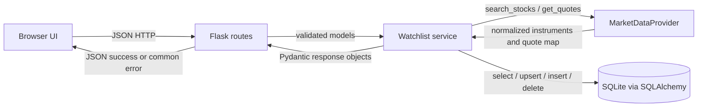

# TradePoint Watchlist — Proposed Stable Contracts

**Purpose:** Single source of truth for the next implementation changes and parallel development. This document distinguishes current behavior from the proposed contract. The proposed contract resolves the audit issues below; it does not claim the current code already follows it. No application code is changed by this document.

## Decision status

The decisions in this document are **approved for implementation planning**. Any future departure requires a coordinated update to this document before interface code changes. The remaining uncertainties are listed at the end.

### Resolved decisions

1. Keep Flask, SQLAlchemy, SQLite, Pydantic, the current service/provider split, and the existing four API routes.
2. Search provider data, then upsert returned instruments into the local `instruments` table. Add first checks the table; if absent, it searches the provider by exact symbol, verifies the returned NSE symbol, stores it, then adds it. Thus a stock chosen from search can be added reliably, and valid uncached symbols can also be resolved.
3. Provider `get_quotes` is a batch interface and service code uses it in batches: one instrument on add, all watchlist instruments in one call on GET. Missing keys mean no quote. A provider exception makes all quote(s) in that call unavailable; saved membership remains unaffected.
4. Serialize prices as **JSON strings** containing a nonnegative decimal with exactly two fractional digits, e.g. `"3865.25"`. This preserves decimal precision and avoids JavaScript number rounding. Frontend displays the string as supplied. Price is strictly positive for available quotes.
5. Quote fields are `price`, `currency`, `as_of`, `simulated`. `as_of` is an ISO 8601 UTC string. `simulated` is a required boolean: true for mock data, false for live data. A missing quote is `null`.
6. All API errors, including Flask 404, 405, and unexpected 500 errors, use the same JSON envelope. Validation messages are stable and concise, not raw Pydantic exception text.
7. New add returns 201; duplicate add returns 200 and the existing item. Deleting absent membership returns 404. No quote is persisted.
8. Keep one configured demo user and no authentication/user table in this milestone.
9. Keep `instrument_token` in the public stock response for now because it is already present in the current API and supports provider lookup. It is an opaque positive integer, not a client-generated value.

## 1. Component responsibilities and flow

| Component | Responsibility |
|---|---|
| Browser / `templates/index.html` | Send JSON requests, display stock search results and watchlist items, send add/delete actions. It does not call the provider or DB. |
| Flask routes / `app.py` | HTTP parsing, request schema validation, call service functions, map known errors to HTTP status and response schema. No business logic or provider-specific fields. |
| Pydantic / `schemas.py` | Validate request and response structures at API boundary, with strict extra-field rejection. |
| Services / `services.py` | Search/upsert instruments, add/list/remove watchlist membership, batch quote requests, convert DB/provider objects to API models. |
| Provider / `provider.py` | Implement normalized search and quote interface. Mock or future Kite adapter owns provider-specific mapping. |
| SQLAlchemy / `models.py`, `database.py` | Store normalized instruments and watchlist membership. Never store current quote prices. |



## 2. API contract

All API requests/responses use `application/json`, except `GET /` which returns HTML. Unknown JSON keys are rejected. JSON response keys and types below are exact. `as_of` is UTC RFC 3339 / ISO 8601 ending in `Z`. `price` is a string, never a JSON number.

### `POST /api/stocks/search`

Request body:

```json
{"query":"Tata","limit":20}
```

`query`: string, trim whitespace, 1–100 characters after trim. `limit`: integer 1–100, defaults to 20. Search matches provider name or symbol (case-insensitive substring for the mock), restricted to NSE equities. Empty results are successful. Search results are upserted into the local instrument cache before responding.

200:

```json
{"results":[{"symbol":"TCS","name":"Tata Consultancy Services","exchange":"NSE","instrument_token":123}]}
```

`results` is an array; `symbol`, `name` strings; `exchange` exactly `"NSE"`; `instrument_token` positive integer.

Errors: 400 `VALIDATION_ERROR`; 503 `PROVIDER_UNAVAILABLE` if provider search fails; 500 `INTERNAL_ERROR` for DB/unexpected failure.

### `POST /api/watchlist`

Request:

```json
{"symbol":"TCS"}
```

`symbol`: string, trim and uppercase, 1–32 characters after trim. Resolve exact NSE symbol from local cache. If absent, call provider search using that symbol, then accept only an exact uppercase NSE symbol match; upsert the instrument. If no exact match, return 404. This makes add work even if the browser’s prior search result was not cached or cache was empty.

201 new / 200 duplicate:

```json
{"item":{"stock":{"symbol":"TCS","name":"Tata Consultancy Services","exchange":"NSE","instrument_token":123},"quote":{"price":"3865.25","currency":"INR","as_of":"2026-11-07T10:30:00Z","simulated":true}},"created":true}
```

`created` is boolean. `quote` is either the quote object or `null`. A quote failure does not roll back or hide the saved entry. Duplicate addition does not create a second row and returns `created:false`.

Errors: 400 `VALIDATION_ERROR`; 404 `STOCK_NOT_FOUND`; 503 `PROVIDER_UNAVAILABLE` only when provider search is needed and fails before an instrument can be resolved; 500 `INTERNAL_ERROR` for DB/unexpected failure. If the stock is already resolved and quote retrieval fails, return success with null quote.

### `GET /api/watchlist`

No request body or parameters. Query all configured demo user’s items, then call `get_quotes` once with the complete instrument list. Empty list skips provider call.

200:

```json
{"items":[{"stock":{"symbol":"TCS","name":"Tata Consultancy Services","exchange":"NSE","instrument_token":123},"quote":{"price":"3865.25","currency":"INR","as_of":"2026-11-07T10:30:00Z","simulated":true}}]}
```

`items` is ordered by `created_at`, then symbol. Each quote may be `null`. Provider exception or absent quote key produces null quote(s), while returning all saved stock entries. DB/unexpected failures return 500 common error.

### `DELETE /api/watchlist/{symbol}`

Path symbol is URL-decoded by Flask, trimmed and uppercased; valid length 1–32. No body.

200: `{"symbol":"TCS","deleted":true}`.

Errors: 400 `VALIDATION_ERROR` for blank/too-long symbol; 404 `WATCHLIST_ITEM_NOT_FOUND` if not in this demo user’s watchlist; 500 `INTERNAL_ERROR` for DB/unexpected failure.

## 3. Pydantic/API data models

These are the required model-level types and rules for the proposed implementation. All request models reject extras.

| Structure | Exact fields |
|---|---|
| `SearchRequest` | `query: str` (trimmed, 1–100); `limit: int = 20` (1–100). |
| `AddWatchlistRequest` | `symbol: str` (trimmed, uppercase, 1–32). |
| `StockSummary` | `symbol: str`; `name: str`; `exchange: Literal["NSE"]`; `instrument_token: int > 0`. |
| `Quote` | `price: str` (positive decimal string, exactly 2 fractional digits); `currency: Literal["INR"]`; `as_of: datetime` normalized to UTC and serialized with `Z`; `simulated: bool`. |
| `WatchlistItem` | `stock: StockSummary`; `quote: Quote \| None` (required key, null permitted). |
| Search response | `results: list[StockSummary]`. |
| Add response | `item: WatchlistItem`; `created: bool`. |
| List response | `items: list[WatchlistItem]`. |
| Delete response | `symbol: str`; `deleted: Literal[true]`. |
| Error response | `error: {code: str, message: str, field: str \| null}`. |

Because Pydantic `Decimal` JSON encoding varies from the desired stable string contract, the API schema should use a validated decimal-string type (or explicit serializer) so the wire type is unambiguously JSON string. The frontend must not parse price into JavaScript `Number` for display.

## 4. Internal service contracts

Function inputs and outputs below are the proposed stable service boundary. Keep Flask `Session` lifetime owned by route/caller; service functions do not open global sessions.

| Function | Input | Output | Failure contract |
|---|---|---|---|
| `seed_instruments(session, provider) -> None` | SQLAlchemy `Session`, `MarketDataProvider` | Seed normalized provider catalog when cache empty. | Provider/DB failure propagates to app startup; log and fail startup rather than run with silently empty cache. Refresh policy remains out of scope. |
| `search(session, provider, query: str, limit: int) -> list[StockSummary]` | Validated query and limit | Provider matches, upsert cache, return canonical rows. | `ProviderUnavailable` or DB exception. |
| `add(session, provider, user_id: str, symbol: str) -> tuple[WatchlistItem, bool]` | User ID and normalized symbol | Resolve cache or exact provider match, upsert, ensure unique membership, quote one instrument, return item and created flag. | `StockNotFound`; provider unavailable only when provider search is required; DB exception. Quote failure returns null quote, not exception. Handle uniqueness race by re-reading duplicate row and returning `created=False`. |
| `list_items(session, provider, user_id: str) -> list[WatchlistItem]` | User ID | Load ordered entries, call provider once with all instruments, map quote keys to items; absent map entries / provider failure => null quotes. | DB/unexpected mapping failure propagates. |
| `remove(session, user_id: str, symbol: str) -> None` | User ID and normalized symbol | Delete matching membership. | `WatchlistItemNotFound`; DB exception. |

Use explicit domain exceptions `StockNotFound`, `WatchlistItemNotFound`, `ProviderUnavailable`. Do not leak exception text or stack traces into HTTP responses. Log unexpected exceptions server-side.

## 5. Provider interface

The interface is application-owned; implementations return normalized TradePoint data, never raw Kite structures.

```python
@dataclass(frozen=True)
class InstrumentData:
    exchange: str              # "NSE" for supported results
    symbol: str
    name: str
    instrument_token: int      # positive integer
    instrument_type: str       # normalized category, e.g. "EQ"

@dataclass(frozen=True)
class QuoteData:
    price: Decimal             # positive INR amount
    as_of: datetime            # timezone-aware UTC instant
    simulated: bool            # true for mock, false for live provider

class MarketDataProvider(Protocol):
    def search_stocks(self, query: str, limit: int = 20) -> list[InstrumentData]: ...
    def get_quotes(
        self, instruments: list[InstrumentData]
    ) -> dict[tuple[str, str], QuoteData]: ...  # key is (exchange, symbol)
```

One `get_quotes` call must accept any list, including one element, and return zero or more keys from that list. Unknown/missing quote keys are normal. Operational failures raise `ProviderUnavailable` (or are translated to it at adapter boundary). `search_stocks` raises the same typed exception for provider outages. Provider-specific fields and Kite mappings stay inside the adapter. Mock values remain visibly simulated.

**Usage rule:** `add` calls `get_quotes([selected_instrument])` once. `list_items` calls `get_quotes(all_watchlist_instruments)` once, not once per row. Both map by `(exchange, symbol)`.

## 6. Database contract

Retain the current tables and constraints:

| Table | Fields and constraints |
|---|---|
| `instruments` | `id INTEGER PRIMARY KEY`; `exchange VARCHAR(8) NOT NULL`; `symbol VARCHAR(32) NOT NULL`; `name VARCHAR(160) NOT NULL`; `instrument_token BIGINT NOT NULL UNIQUE`; `instrument_type VARCHAR(16) NOT NULL`; unique `(exchange, symbol)`. |
| `watchlist_entries` | `id INTEGER PRIMARY KEY`; `user_id VARCHAR(128) NOT NULL`; `instrument_id INTEGER NOT NULL REFERENCES instruments(id) ON DELETE RESTRICT`; `created_at DATETIME NOT NULL DEFAULT current timestamp`; unique `(user_id, instrument_id)`. |

Enable SQLite foreign keys on every connection. No ORM relationship property is required by this contract. Do not add quote columns. Continue using `TRADEPOINT_DATABASE_URL` and `TRADEPOINT_DEMO_USER_ID` (default `demo-user`). Token global uniqueness is retained for this milestone; verify provider catalog compatibility before changing it.

Cache writes are upserts by `(exchange, symbol)`: update name, token, and type when an existing instrument is found. Any token uniqueness conflict for a different symbol is a data-integrity error and must not silently overwrite another instrument.

## 7. Standard error contract

Every API failure, including unknown route, unsupported method, bad content type, malformed JSON, provider failure, DB failure, and unexpected exception, returns `application/json` with:

```json
{"error":{"code":"STOCK_NOT_FOUND","message":"No matching NSE equity was found.","field":"symbol"}}
```

`field` is null when no single request field caused the failure. `message` is short and stable; Pydantic internals and stack traces are server-only. Flask HTTP exception handlers should translate framework 404/405 to `NOT_FOUND` / `METHOD_NOT_ALLOWED` in this shape.

| HTTP | Code | Use |
|---|---|---|
| 400 | `VALIDATION_ERROR` | Invalid JSON, wrong content type, unknown keys, invalid field or path. |
| 404 | `STOCK_NOT_FOUND` | Add symbol cannot be resolved to an exact NSE equity. |
| 404 | `WATCHLIST_ITEM_NOT_FOUND` | Delete target is not saved. |
| 404 | `NOT_FOUND` | Unknown API path. |
| 405 | `METHOD_NOT_ALLOWED` | Known path with unsupported method. |
| 503 | `PROVIDER_UNAVAILABLE` | Required search operation cannot reach provider. Quote outages are partial success with null quote. |
| 500 | `INTERNAL_ERROR` | Database or unexpected server failure. |

Validation error examples must be deterministic, e.g. `{"error":{"code":"VALIDATION_ERROR","message":"query must not be empty","field":"query"}}`. Do not expose raw Pydantic error dumps.

## 8. Frontend contract

- Search sends `POST /api/stocks/search` `{query: string, limit: 20}`; reads `results[]` and uses `name`, `symbol`.
- Selecting a result sends `POST /api/watchlist` `{symbol: string}`; treats both 200 and 201 as success; reads `item` if needed and refreshes via GET.
- Initial load and refresh send `GET /api/watchlist`; reads `items[]`, each containing `stock` and nullable `quote`.
- Price is rendered as the supplied decimal string plus currency; do not convert to JS number. `simulated:true` displays “Simulated quote”; false may display “Quote available”. Null displays “Unavailable”.
- Remove sends `DELETE /api/watchlist/{encoded symbol}`; on 200 refreshes list.
- For any non-2xx response, parse common error envelope and display `error.message`; malformed/non-JSON network responses get a generic client fallback.
- Continue safe DOM insertion with `textContent`; no page reload required.

## 9. Current implementation differences to close

The current source does **not** yet meet all proposed contracts. Specifically: search calls provider and inserts only returned rows; existing cache rows are not refreshed; add only checks DB and does not provider-resolve an uncached symbol; list makes one provider call per stock; `Quote` uses `Decimal` and does not fix wire JSON type/scale; GET route lacks error wrapping; Flask default 404/405 are not standardized; provider exception type is absent; add’s generic 500 message can falsely say the stock was saved; delete path does not validate max length; SQL uniqueness races can return 500; and provider exceptions during quote are swallowed broadly. These are implementation tasks to bring code into this contract, not behaviors to rely on today.

## 10. Parallel ownership

| Developer | Independent ownership | Contract boundary |
|---|---|---|
| 1 — Frontend | `templates/index.html` | Own browser UI and `fetch` behavior. Keep endpoint paths, JSON keys, status handling, and price-as-string behavior in sections 2 and 8. |
| 2 — Provider | `provider.py` and future provider adapter module if needed | Own mock/provider implementation. Preserve `InstrumentData`, `QuoteData`, `MarketDataProvider` names, types, and batch semantics in section 5. Do not change API schemas or DB models. |
| 3 — Backend integration | `app.py`, `services.py`, `schemas.py`, `models.py`, `database.py`, `config.py` | Own routes, validation, service flow, DB access, and error mapping. Preserve the public/provider contracts here; coordinate any breaking change first. |

**Shared files:** `CONTRACTS.md` is jointly owned; update it before or with any agreed interface change. `requirements.txt` and `README.md` are shared maintenance files. Schema changes touch service code and require Developer 3 coordination. Provider signatures/data structures require Developer 2 coordination. API response/request changes require Developer 1 coordination. The proposed backend set is internally coupled and should remain with one owner rather than be split file-by-file.

## 11. Remaining uncertainties

These do not block implementation of the above contract; defer unless product requirements change:

1. Search ranking and tie-breaking beyond provider order. The mock keeps catalog order; no ranking guarantee is needed for MVP.
2. Instrument cache refresh cadence. Current milestone seeds an empty cache and upserts search/add results; periodic refresh is out of scope.
3. Quote timeout/retry policy and provider rate limits. For now adapter must use bounded timeouts; exact values can be chosen in provider implementation and documented there.
4. Whether public clients ultimately need `instrument_token`. Keep it for compatibility in this milestone; revisiting is a versioned API decision.
5. Any future authentication/multiple users or live Kite credentials. Both are explicitly outside this milestone.
